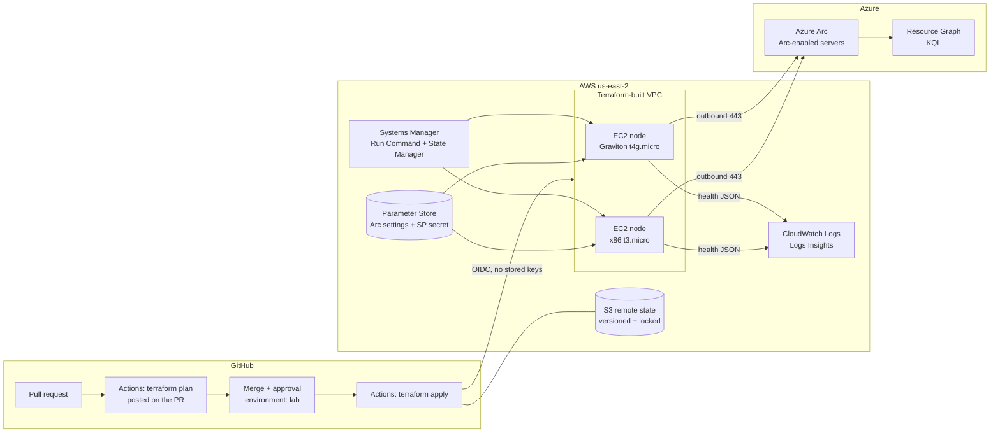

# Lab 7 Capstone: Multi-cloud fleet on AWS, managed from AWS and Azure

Two EC2 nodes (one Graviton/Arm, one x86) are built with Terraform through a GitHub Actions pipeline, then managed from **both** AWS Systems Manager and Azure Arc, with a health report that answers the same question from each cloud: *which nodes need attention?*

Built by Susheel Vemaraju (Azure Cloud Engineer, 8+ years) as a hands-on AWS project.

## Architecture



## How a change flows

1. Change Terraform code on a branch and open a pull request.
2. GitHub Actions runs `fmt`, `init`, `validate` and `plan`, and posts the plan as a PR comment.
3. After review, merge. The `apply` job waits for approval in the `lab` environment.
4. On approval, Terraform applies the change. State lives in S3 with locking.

Proof: adding an `Owner` tag in `providers.tf` produced `~ update in-place` (0 to add, 0 to destroy) and the tag appeared on every resource after the approved apply.

## What's in this folder

```
.github/workflows/terraform.yml   (at repo root) plan on PR, gated apply, manual destroy
lab7-capstone/
├── terraform/        providers, variables, network, compute, monitoring, S3 backend
├── scripts/
│   ├── onboard-arc.sh             Azure Arc onboarding, run by SSM Run Command
│   ├── health-check.sh            node health as one JSON line, run by State Manager
│   └── cloudwatch-agent-setup.sh  ships the health log to CloudWatch
├── queries/
│   ├── arc-fleet.kql              Azure Resource Graph: Arc machines and hardware
│   ├── arc-needs-attention.kql    Azure Resource Graph: disconnected machines
│   └── fleet-health.logsinsights  CloudWatch Logs Insights: nodes needing attention
├── notes-phase1.md … notes-phase5.md
└── screenshots/
```

## Key design decisions

| Area | Decision | Why |
|---|---|---|
| Pipeline auth | GitHub OIDC → IAM role, trust limited to this repo's immutable `sub` (owner and repo IDs) | No long-lived AWS keys; repo renames can't be abused |
| Pipeline permissions | PowerUserAccess + IAM actions only on `lab7-*` | Least privilege: can't touch other IAM roles |
| State | S3 backend, versioning, encryption, native lock file | Shared, recoverable, no concurrent applies |
| Change control | PR plan comment + environment approval before apply | Review before change, full audit trail |
| Node access | No inbound rules, no SSH keys; Session Manager only | Nothing exposed to the internet |
| Arc onboarding | SSM Run Command by tag; secret in Parameter Store (SecureString); SP with only "Azure Connected Machine Onboarding" on one RG | No secrets in Git; small blast radius; works after rebuilds |
| Health | State Manager runs a check every 30 min → CloudWatch Logs; Arc status via Resource Graph | Same question answered from both control planes |

## Health report

Each node reports: instance type, architecture, uptime, disk %, available memory, scheduled AWS maintenance events (from IMDS), and Azure Arc agent status. A node "needs attention" if maintenance is scheduled, disk is 80% or more, memory is low, or Arc is not connected.

- **AWS view:** `queries/fleet-health.logsinsights`, run in CloudWatch Logs Insights
- **Azure view:** `queries/arc-needs-attention.kql`, run in Azure Resource Graph
- The `AwsInstanceId` tag on each Arc machine links the Azure record to its EC2 instance.

Tested by filling the x86 node's disk past 80% (AWS view flagged `disk-high` within a minute) and stopping the Arc agent on the Arm node (the AWS view flagged `arc-not-connected` within a minute; Azure marked the machine `Disconnected` after its ~15-minute heartbeat window, then `Connected` again after recovery). The node detects its own problem fast; the control plane confirms it independently.

## Troubleshooting highlights

1. **`Not authorized to perform sts:AssumeRoleWithWebIdentity`:** decoded the OIDC token claims and found GitHub's immutable subject format (`repo:owner@id/repo@id:...`); updated the trust policy.
2. **S3 403 on state:** the IAM policy simulator showed an SCP deny only because no region was passed (a region-restricting SCP). With `aws:RequestedRegion` set, it showed `implicitDeny`: the role had no permission policies. Attached them and verified.
3. **Push rejected for workflow file:** the token needed the Workflows permission.
4. **Arc onboarding curl exit 23:** stepped through by hand in Session Manager; the write to `/tmp` failed. Moved the download and made the script idempotent.
5. **`terraform init` "no space left on device" in CloudShell:** 1 GB home limit; cleared the old provider cache.
6. **Logs Insights "Cycle found in operation dependency graph":** an alias reused its own field name (`latest(arch) as arch`); renamed the aliases.
7. **Arc agent restarted itself during the outage test:** dependent agent services pulled `himdsd` back up. Simulated the outage with `systemctl mask --runtime --now himdsd`, then unmasked and started it to recover.

## Run it yourself

1. Bootstrap the S3 state bucket (versioning, public access block) and set it in `terraform/backend.tf`.
2. Create the GitHub OIDC provider and the `github-actions-lab7` role; set the repo variable `AWS_ROLE_ARN` and the `lab` environment with a required reviewer.
3. Open a PR → review the plan → merge → approve.
4. Azure: register the Arc providers, create `rg-lab7-arc` and the onboarding service principal; store its values under `/lab7/arc/` in Parameter Store.
5. Run `scripts/onboard-arc.sh` with SSM Run Command, targeting tag `Role=fleet-node`.
6. Run `scripts/cloudwatch-agent-setup.sh` once, then create the State Manager association with `scripts/health-check.sh`.

## Cost and cleanup

Two micro instances, an S3 bucket and small CloudWatch logs: cents per day. Arc connection is free (no paid extensions enabled). A $10 AWS budget alert is set.

Cleanup order: delete Azure resource group `rg-lab7-arc` → delete the service principal → delete the State Manager association and `/lab7/arc/*` parameters → run the pipeline's **destroy**.
